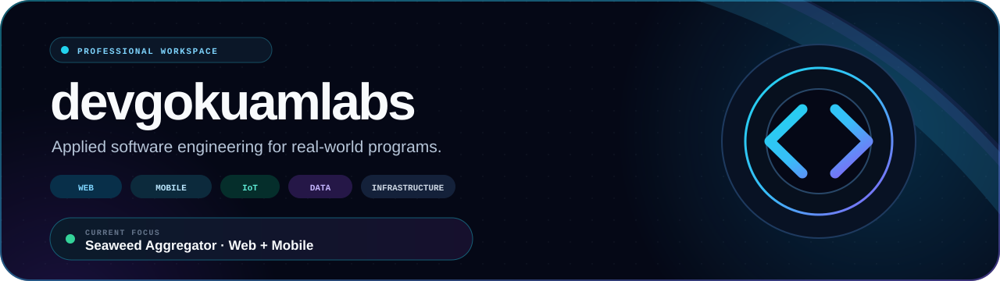
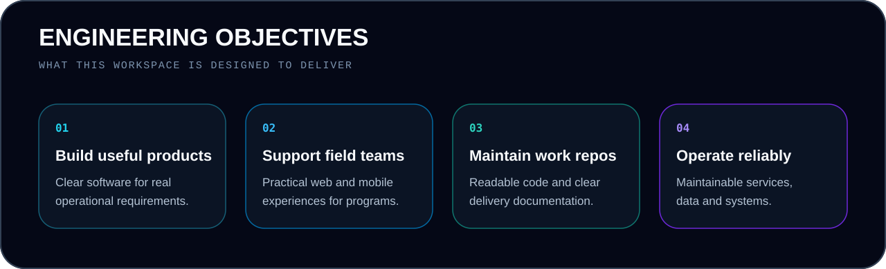
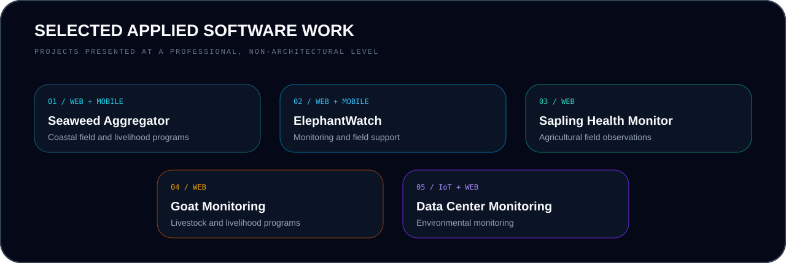
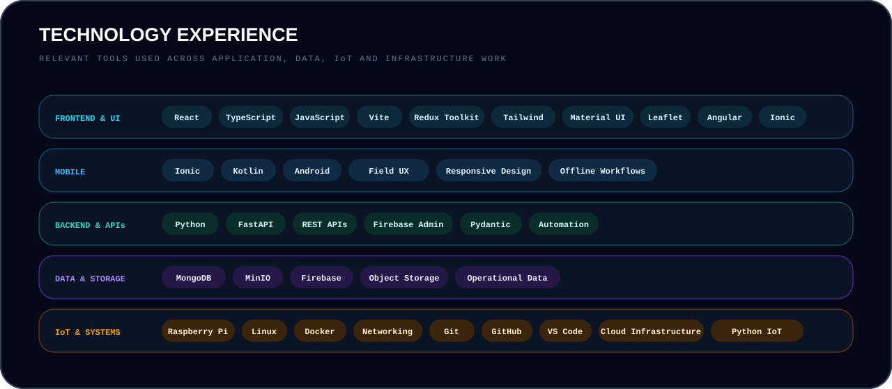
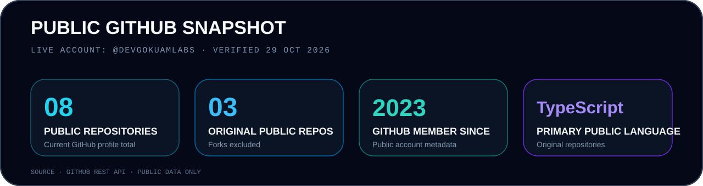

<div align="center">
  
</div>

<div align="center">
  <a href="https://github.com/devgokuamlabs"></a>
  <a href="#current-focus"></a>
  <a href="https://github.com/ruraltechammachilabs"></a>
</div>

# `01 / Introduction`

## Building dependable digital tools for real-world programs.

I work across **web platforms, mobile applications, IoT monitoring, backend services, data systems, and Linux infrastructure**. This account is the professional workspace where I maintain work-related repositories, delivery references, prototypes, and engineering documentation.

My focus is applied software engineering: understand the field requirement, create a clear user experience, build maintainable software, and keep the operational path reliable.

<table>
  <tr>
    <td width="33%" valign="top">
      <h2>Build</h2>
      <p>Useful web and mobile products shaped by real operational needs.</p>
    </td>
    <td width="33%" valign="top">
      <h2>Connect</h2>
      <p>Applications that bring field activity, IoT signals, data, and teams together.</p>
    </td>
    <td width="34%" valign="top">
      <h2>Maintain</h2>
      <p>Readable repositories, practical documentation, and dependable delivery.</p>
    </td>
  </tr>
</table>

<div align="center">
  
</div>

# `02 / Current Focus`

<a id="current-focus"></a>

<table>
  <tr>
    <td width="70%">
      <h1>Seaweed Aggregator</h1>
      <h3>Website + mobile application · active development</h3>
      <p>Contributing to a digital platform that supports seaweed cultivation programs, coastal field activities, livelihood workflows, and coordinated service delivery.</p>
      <p><strong>Contribution areas</strong></p>
      <ul>
        <li>Full-stack application development</li>
        <li>Field-focused web and mobile experiences</li>
        <li>Operational dashboards and user workflows</li>
        <li>Maintainable repository and release practices</li>
      </ul>
    </td>
    <td width="30%" align="center">
      <br><br>
      <br>
      
    </td>
  </tr>
</table>

# `03 / Selected Work`

<div align="center">
  
</div>

<table>
  <tr>
    <td width="50%" valign="top">
      <h2>Seaweed Aggregator</h2>
      <code>Website + Mobile Application</code>
      <p>Worked on digital tools supporting coastal cultivation programs, field activities, and operational workflows.</p>
    </td>
    <td width="50%" valign="top">
      <h2>ElephantWatch</h2>
      <code>Website + Mobile Application</code>
      <p>Worked on field-facing software supporting elephant monitoring and community early-warning use cases.</p>
    </td>
  </tr>
  <tr>
    <td width="50%" valign="top">
      <h2>Sapling Health Monitor</h2>
      <code>Website</code>
      <p>Worked on a website supporting sapling health observations, irrigation tracking, and field monitoring.</p>
    </td>
    <td width="50%" valign="top">
      <h2>Goat Monitoring</h2>
      <code>Website</code>
      <p>Worked on software supporting livestock observations and rural livelihood programs.</p>
    </td>
  </tr>
  <tr>
    <td width="50%" valign="top">
      <h2>Data Center Monitoring</h2>
      <code>IoT Website</code>
      <p>Worked on an IoT monitoring website for temperature, humidity, and smoke using Raspberry Pi-connected sensors.</p>
      <a href="https://github.com/ruraltechammachilabs/temperature-monitor-frontend">View public repository →</a>
    </td>
    <td width="50%" valign="top">
      <h2>Additional Engineering Work</h2>
      <p><a href="https://github.com/ruraltechammachilabs/airanya_admin_server"><strong>AIranya</strong></a> — backend work for image annotation and classification workflows.</p>
      <p><a href="https://github.com/ruraltechammachilabs/coconuthealth_v2"><strong>Coconut Health</strong></a> — agricultural health and field data interfaces.</p>
    </td>
  </tr>
</table>

# `04 / Technology Experience`

<div align="center">
  
</div>

<div align="center">
  
</div>

<table>
  <tr><td><strong>Frontend</strong></td><td>React · TypeScript · JavaScript · Angular · Ionic · Vite · Redux Toolkit · Tailwind · Material UI · Leaflet</td></tr>
  <tr><td><strong>Mobile</strong></td><td>Field applications · Ionic · Android · Kotlin · responsive and offline-aware experiences</td></tr>
  <tr><td><strong>Backend</strong></td><td>Python · FastAPI · REST APIs · Firebase Admin · Pydantic</td></tr>
  <tr><td><strong>Data</strong></td><td>MongoDB · MinIO · Firebase · object storage</td></tr>
  <tr><td><strong>IoT</strong></td><td>Raspberry Pi · Python IoT · environmental monitoring applications</td></tr>
  <tr><td><strong>Infrastructure</strong></td><td>Linux server management · networking · file management · remote development · cloud infrastructure · Docker</td></tr>
</table>

# `05 / Repository Practice`

```text
clarify requirements
      ↓
design the user workflow
      ↓
build maintainable software
      ↓
document operational knowledge
      ↓
review, release and improve
```

**Working principles:** clear ownership · readable code · practical documentation · reproducible environments · observable delivery · continuous improvement

# `06 / GitHub Telemetry`

## Public telemetry for `@devgokuamlabs`

The snapshot below is based on the **current public GitHub profile**, verified on **29 October 2026**. Private repositories and internal project details are intentionally excluded.

<div align="center">
  
</div>

### Live GitHub cards

<div align="center">
  
  
</div>

<div align="center">
  
  
</div>

<div align="center">
  
</div>

<div align="center">
  
</div>

<div align="center">
  <sub>Professional workspace for applied software engineering and work-related repository maintenance.</sub>
</div>
